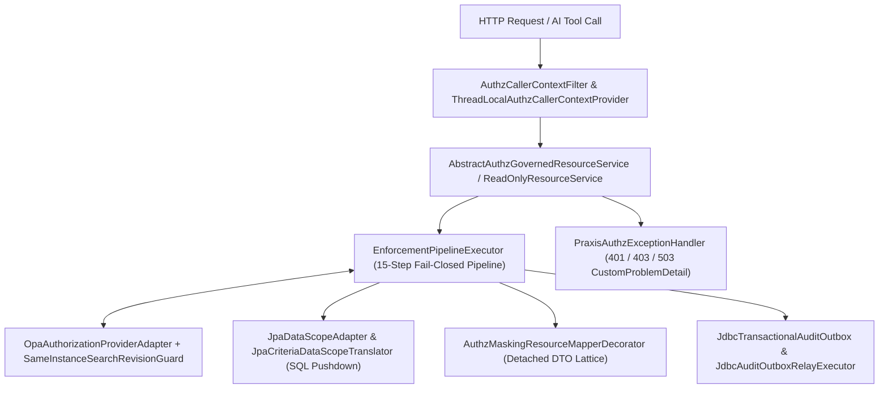

# Praxis Authz Starter

[](https://central.sonatype.com/artifact/io.github.codexrodrigues/praxis-authz-starter)


[](LICENSE)

Spring Boot 3.5 auto-configuration, `praxis-metadata-starter` governed resource services, startup compatibility verification, Actuator readiness health checks, PostgreSQL RLS session guards, transactional JDBC audit outbox, and fail-closed `RestControllerAdvice` error mapping for the **Praxis Authorization Decision Platform**.

**Quick Links:**
[Maven Central](https://central.sonatype.com/artifact/io.github.codexrodrigues/praxis-authz-starter) ·
[Changelog](CHANGELOG.md) ·
[Releasing](RELEASING.md) ·
[Contributing](CONTRIBUTING.md) ·
[Security Policy](SECURITY.md) ·
[Contracts](https://github.com/codexrodrigues/praxis-authz-contracts) ·
[Enforcement Core](https://github.com/codexrodrigues/praxis-authz-enforcement-core) ·
[OPA Provider](https://github.com/codexrodrigues/praxis-authz-opa)

---

## Praxis Decision Platform & Architectural Thesis

The **Praxis Platform** is a **semantically oriented platform for AI-native enterprise applications**, in which **resources, rules, actions, data, and policies are described once** and operated uniformly by **traditional UIs, generative UIs, AI agents, and integrations** — building applications that are legible and operable by AI by design rather than bolting AI onto the side.

Within the Praxis Decision Platform, `praxis-authz-starter` is the Spring Boot host runtime bridge for `decisionKind = AUTHORIZATION`:

| Plane | Canonical Owner | Responsibilities |
| :--- | :--- | :--- |
| **Resource & Domain Semantics** | [`praxis-metadata-starter`](https://github.com/codexrodrigues/praxis-metadata-starter) | `@ApiResource`, `x-ui`, `/schemas/filtered`, `/schemas/domain`, `@DomainGovernance`, `@DomainLineage`, `@Filterable`, `@WorkflowAction`, `@UiSurface`, stats, and export |
| **Control Plane & Governed Decisions** | [`praxis-config-starter`](https://github.com/codexrodrigues/praxis-config-starter) / [`praxis-config-contracts`](https://github.com/codexrodrigues/praxis-config-contracts) | UI config, AI registry, API grounding, maker-checker approvals, and snapshot head lifecycle (`/api/praxis/config/**`) |
| **`decisionKind = BUSINESS`** | [`praxis-rules-engine`](https://github.com/codexrodrigues/praxis-rules-engine) | Deterministic 5-state domain invariants, eligibility, and calculations (`RuleSet` / JSON Logic) |
| **`decisionKind = AUTHORIZATION`** | [`contracts`](https://github.com/codexrodrigues/praxis-authz-contracts) -> [`enforcement-core`](https://github.com/codexrodrigues/praxis-authz-enforcement-core) -> [`opa`](https://github.com/codexrodrigues/praxis-authz-opa) -> **`praxis-authz-starter`** | Spring Boot 3.5 PEP orchestration, `AbstractAuthzGovernedResourceService`, `@WorkflowAction` / `@UiSurface` availability, governed stats/export/options/determinations/bulk, RLS, and outbox |

---

## Spring Boot Host Enforcement Architecture



---

## 5-Minute Host Quickstart

### 1. Add Maven Dependency

Requires **Java 21** and **Spring Boot 3.5.x**:

```xml
<dependency>
    <groupId>io.github.codexrodrigues</groupId>
    <artifactId>praxis-authz-starter</artifactId>
    <version>0.1.0-beta.1</version>
</dependency>
```

Adding `praxis-authz-starter` automatically brings in `praxis-authz-contracts`, `praxis-authz-enforcement-core`, and `praxis-authz-opa`. Host bridges for `praxis-metadata-starter`, `praxis-config-starter`, Spring Data JPA, Spring Web, Actuator, and JDBC activate cleanly via conditional auto-configuration.

### 2. Derive a Resource Spec & Extend the Governed Base Service

Use zero-blueprint introspection (`AuthzResourceGovernanceSpec.fromAnnotatedResource(...)`) so `@ApiResource`, `@WorkflowAction`, `@UiSurface`, `@Filterable`, `@DomainGovernance`, and `@DomainLineage` on your Praxis resource define decision points, fact contracts, queryable projections, and JPA path bindings automatically:

```java
import org.praxisplatform.authz.host.metadata.AbstractAuthzGovernedResourceService;
import org.praxisplatform.authz.host.metadata.AuthzResourceGovernanceSpec;
import org.praxisplatform.uischema.annotation.ApiResource;

public class EmployeeLeaveService extends AbstractAuthzGovernedResourceService<
        EmployeeLeaveEntity,
        EmployeeLeaveResponseDTO,
        Long,
        EmployeeLeaveFilterDTO,
        EmployeeLeaveCreateDTO,
        EmployeeLeaveUpdateDTO> {

    private static final AuthzResourceGovernanceSpec<EmployeeLeaveEntity> SPEC =
            AuthzResourceGovernanceSpec.fromAnnotatedResource(
                    "hr-service",
                    "tenantId",
                    EmployeeLeaveEntity.class,
                    EmployeeLeaveResponseDTO.class,
                    EmployeeLeaveFilterDTO.class,
                    EmployeeLeaveController.class
            );
}
```

For read-only projections and `Radar*` endpoints, extend `AbstractAuthzGovernedReadOnlyResourceService<E, ResponseDTO, ID, FilterDTO>`.

### 3. Bootstrap Coordinates, Policies & Readiness Gate

```java
import java.util.List;
import org.praxisplatform.authz.host.metadata.AuthzHostPolicyBootstrapBuilder;
import org.praxisplatform.authz.host.metadata.AuthzHostReadinessReviewer;

AuthzHostPolicyBootstrapBuilder.AuthzHostPolicyBootstrapBundle bundle =
        AuthzHostPolicyBootstrapBuilder.forService("hr-service")
                .addGovernedService(employeeLeaveService)
                .addOrganizationalScopePolicy(
                        EmployeeLeaveService.SPEC,
                        "rule-org-scope",
                        "resource.departmentId",
                        "subject.organizationUnitIds",
                        java.util.Map.of("human-resources.employee-leaves:taxId", "***")
                )
                .build();

new AuthzHostReadinessReviewer()
        .reviewAll(List.of(), List.of(employeeLeaveService))
        .assertReady(); // enforces AUTHZ-HOST-001 through AUTHZ-HOST-014
```

### 4. Configure `application.yml`

```yaml
praxis:
  authz:
    enabled: true
    fail-closed-on-bootstrap-error: true
    require-bindings-on-startup: true
    masking-hmac-secret: ${PRAXIS_AUTHZ_HMAC_SECRET}
    opa:
      http-transport-enabled: true
      base-url: http://127.0.0.1:8181
      instance-id: opa-primary-1
      request-timeout: 1500ms
      search-max-same-instance-retries: 1
```

---

## Package & Component Map

| Package | Key Types | Role |
| :--- | :--- | :--- |
| `org.praxisplatform.authz.autoconfigure` | `PraxisAuthzAutoConfiguration`, `PraxisAuthzHostBridgeAutoConfiguration`, `PraxisAuthzProperties`, `PraxisAuthzBootstrapException` | Auto-configures the 15-step PEP pipeline, startup compatibility verification, fail-closed `PraxisAuthzHostBridgeAutoConfiguration` (ordered before `OpenApiUiSchemaAutoConfiguration`), and HTTP transport adapters |
| `org.praxisplatform.authz.host.metadata` | `AuthzResourceGovernanceSpec`, `AbstractAuthzGovernedResourceService`, `AbstractAuthzGovernedReadOnlyResourceService`, `AuthzHostPolicyBootstrapBuilder`, `AuthzHostReadinessReviewer`, `MetadataDtoGovernanceIntrospector`, `AuthzMaskingResourceMapperDecorator`, `AuthzResourceOperationAvailabilityProvider`, `JpaCriteriaDataScopeTranslator`, `AuthzGovernedStatsQueryExecutor`, `AuthzGovernedOptionSourceProvider`, `AuthzGovernedReactiveDeterminationProvider`, `AuthzGovernedBulkDomainResourceAdapter`, `AuthzGovernedCollectionExportExecutor`, `PraxisAuthzExceptionHandler` | Seamless integration with `praxis-metadata-starter`: DTO governance introspection, SQL predicate pushdown, masked mapping, HATEOAS/surface/action availability, governed stats, option sources, reactive determinations, bulk updates, and `AUTHZ-HOST-001..014` readiness audits |
| `org.praxisplatform.authz.compatibility` | `HostPolicyCompatibilityStartupVerifier`, `HostRuntimePolicyCoordinates`, `PraxisAuthzReadinessHealthIndicator`, `PraxisAuthzReadinessStatus` | Runs the startup compatibility handshake (`P20`, `P39`, `P48`, `P59`) and publishes Spring Boot Actuator health details (`runtimeRevision`, `policySetDigest`, `verifiedDecisionPointCount`) |
| `org.praxisplatform.authz.catalog` | `SemanticDecisionPointCatalogService`, `MethodBindingAdmissionRecord`, `FieldLineageCatalogEntry`, `AdmittedInvocationChannel`, `PapCatalogQueryRequest`, `PapCatalogViewResponse` | Publishes structural decision-point and field-lineage catalogs for PAP governance without executing business methods or reading live tenant data |
| `org.praxisplatform.authz.channel` | `GovernedChannelInvocationExecutor` | Prevents unproxied self-invocation bypass (`P41`), preserves outer `EvaluationContextSnapshot` (`P29`), re-evaluates inner decision points (`P42`), and masks cache hits (`P26`) |
| `org.praxisplatform.authz.export` & `seams` | `GovernedCollectionExportGuard`, `MetadataResourceAuthorizationSeam`, `GovernedExportAndAiToolAuthorizationSeam`, `RuntimeDecisionPointRegistry` | Guards CSV/JSON/EXCEL collection exports against `OpaRuntimeHead` drift and formula injection, and masks AI/metadata projections fail-closed |
| `org.praxisplatform.authz.outbox` | `JdbcTransactionalAuditOutbox`, `JdbcAuditOutboxRelayExecutor`, `AuditOutboxDeliverySinkPort` | Persists `DURABLE_AUDIT_EVIDENCE` obligations inside the active business transaction and relays them asynchronously (`P25`, `P45`) |
| `org.praxisplatform.authz.controlplane` & `host.config` | `ConfigMaterializationToOpaReconciler`, `GovernedPapAdminOperationsService`, `OperationalPolicyResolutionBridge` | Reconciles `praxis-config-starter` maker-checker `DomainRuleMaterialization` heads into compiled OPA bundles and revokes superseded/withdrawn heads immediately |
| `org.praxisplatform.authz.pilot` | `JdbcSessionContextIsolationGuard`, `GovernedPolicyAuthoringGateway`, `AfastamentoAuthzPilotBlueprint`, `AfastamentoPilotRuntimeHost` | Validates non-bypass DB roles, pins transaction-scoped PostgreSQL RLS variables, scrubs pooled JDBC connections in `finally`, and provides reference pilot blueprints |
| `org.praxisplatform.authz.telemetry` | `SanitizedAuthorizationTelemetryPublisher`, `AuthorizationTelemetrySinkPort` | Publishes sanitized decision telemetry strictly without secret values, raw PII, or leaked credentials |

---

## Configuration Properties (`praxis.authz.*`)

| Property | Default | Description |
| :--- | :--- | :--- |
| `praxis.authz.enabled` | `true` | Master toggle for Praxis Authz auto-configuration |
| `praxis.authz.fail-closed-on-bootstrap-error` | `true` | Fails startup immediately when single-provider or compatibility invariants break |
| `praxis.authz.require-bindings-on-startup` | `true` | Requires runtime decision point bindings during startup compatibility verification |
| `praxis.authz.masking-hmac-secret` | `praxis-default-hmac-key-2026` | HMAC key used by `HASH_TOKEN_KEYED` masking (non-blank; **override in production**) |
| `praxis.authz.opa.http-transport-enabled` | `false` | Enables auto-configured `HttpClientOpaTransport` targeting OPA over HTTP |
| `praxis.authz.opa.base-url` | `http://127.0.0.1:8181` | Base HTTP URL for OPA REST data queries |
| `praxis.authz.opa.instance-id` | `opa-primary-1` | Default logical OPA instance identifier (`X-OPA-Instance-Id`) |
| `praxis.authz.opa.request-timeout` | `1500ms` | Bounded timeout per OPA HTTP query |
| `praxis.authz.opa.search-max-same-instance-retries` | `1` | Maximum same-instance retries on benign bundle rotation during `SEARCH` (`0..3`) |
| `praxis.authz.compatibility.verify-on-startup` | `true` | Executes `HostPolicyCompatibilityStartupVerifier` on startup |
| `praxis.authz.discovery.required-catalog-authority` | `praxis:authz:pap:catalog:read` | Authority required to query `SemanticDecisionPointCatalogService` |
| `praxis.authz.discovery.max-lineage-depth` | `8` | Maximum DTO field-lineage recursion depth during catalog introspection |
| `praxis.authz.discovery.max-lineage-branches` | `64` | Maximum field-lineage fan-out branches inspected per decision point |
| `praxis.authz.jdbc.admitted-db-roles` | `["praxis_app_rls_user", "ergon_app_rls_user"]` | Non-bypass PostgreSQL DB roles admitted by `JdbcSessionContextIsolationGuard` |
| `praxis.authz.outbox.jdbc-enabled` | `true` | Enables JDBC transactional audit outbox storage |
| `praxis.authz.outbox.table-name` | `praxis_authz_obligation_outbox` | Relational outbox table name |
| `praxis.authz.outbox.initialize-schema` | `true` | Creates the outbox table automatically when absent |
| `praxis.authz.outbox.require-active-transaction` | `true` | Rejects `DURABLE_AUDIT_EVIDENCE` capture outside an active DB transaction |
| `praxis.authz.outbox.max-delivery-attempts` | `3` | Maximum relay delivery attempts per outbox record |
| `praxis.authz.outbox.relay-batch-size` | `100` | Batch size processed per outbox relay cycle |
| `praxis.authz.admin-endpoints.enabled` | `false` | Enables governed PAP reconciliation/admin operations when explicitly opted in |
| `praxis.authz.admin-endpoints.required-reconcile-authority` | `POLICY_ADMIN_PUBLISH` | Authority required for OPA policy reconciliation and activation |
| `praxis.authz.telemetry.max-buffered-events` | `256` | Bounded in-memory event capacity in `SanitizedAuthorizationTelemetryPublisher` |
| `praxis.authz.readiness-gate.verify-on-startup` | `false` | Optionally runs `AuthzHostReadinessReviewer` checks during Spring Boot startup |
| `praxis.authz.readiness-gate.fail-on-warning` | `false` | Escalates `Severity.WARNING` readiness findings to startup failures |

---

## Semantic HTTP Error Mapping (`PraxisAuthzExceptionHandler`)

| Exception | HTTP Status | Error Category & Code | Extra ProblemDetail Properties |
| :--- | :--- | :--- | :--- |
| `AuthzUnauthenticatedException` | `401 Unauthorized` | `SECURITY` · `ex.getReasonCode()` | — |
| `AuthzProviderUnavailableException` | `503 Service Unavailable` | `SYSTEM` · `ex.getReasonCode()` | `decisionPointKey`, `gateOutcome` |
| `UntrustedHeaderSpoofingException` | `403 Forbidden` | `SECURITY` · `AUTHZ_HEADER_SPOOFING` | `attemptedTargetFactPath`, target `headerName` |
| `FieldUseViolationException` | `403 Forbidden` | `SECURITY` · `AUTHZ_FIELD_USE_DENIED` | `fieldUseCategory`, `forbiddenAttributeIds` |
| `FieldWriteViolationException` | `403 Forbidden` | `SECURITY` · `ex.getReasonCode()` | `forbiddenAttributeIds` |
| `AuthzAccessDeniedException` | `403 Forbidden` | `SECURITY` · `ex.getReasonCode()` | `decisionPointKey`, `gateOutcome` |
| `SecurityException` | `401` or `403` | `SECURITY` · `AUTHZ_*` prefix or fallback `AUTHZ_UNAUTHENTICATED` / `AUTHZ_ACCESS_DENIED` | Maps `AUTHZ_CALLER_CONTEXT_MISSING` and `AUTHZ_AI_METADATA_UNAUTHENTICATED` to `401` |

---

## Build, Conformance Matrix & Governance

The starter suite includes full `P01..P64` conformance verification (`P01ToP64CompleteConformanceMatrixTest`), Spring Boot context auto-configuration tests (`PraxisAuthzAutoConfigurationAndBootstrapTest`), real `AbstractBaseResourceService` integration (`P102RealAbstractBaseResourceServiceIntegrationTest`), HTTP & reentrant proxy enforcement (`P11HttpAndReentrantServiceIntegrationTest`), OPA sidecar/export/AI seam checks (`P9HttpOpaSidecarExportAiSeamAndTelemetryTest`), and cross-host delegation (`CrossHostPilotReuseAndDualScopeEndToEndTest`).

Run local verification with JDK 21 and Maven 3.9+:

```powershell
mvn -B clean verify
```

Related repository documentation:
- [CHANGELOG.md](CHANGELOG.md) — version history and published artifacts
- [RELEASING.md](RELEASING.md) — multi-repository release order and Maven Central publication flow
- [ACTIONS-RELEASE-POLICY.md](ACTIONS-RELEASE-POLICY.md) — GitHub Actions usage and release gate policy
- [CONTRIBUTING.md](CONTRIBUTING.md) — module boundaries, enforcer rules, and contribution workflow
- [SECURITY.md](SECURITY.md) — vulnerability disclosure and fail-closed security invariants
- [AGENTS.md](AGENTS.md) — coding and governance rules for autonomous agents

## License

Licensed under the [Apache License, Version 2.0](LICENSE).
