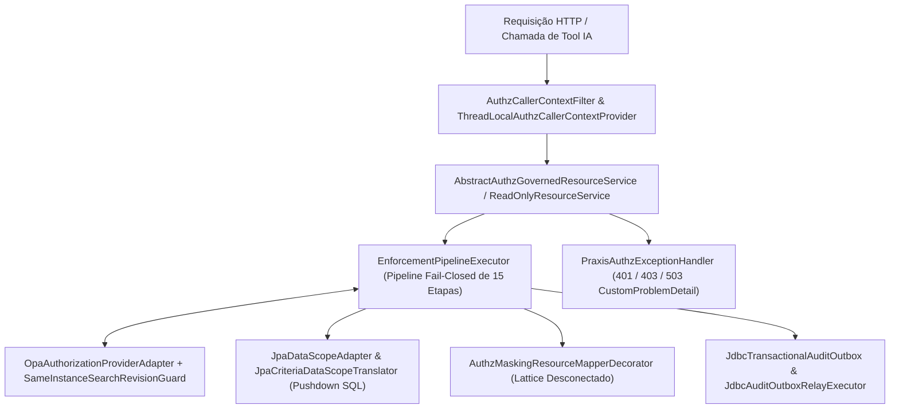

# Praxis Authz Starter

[](https://central.sonatype.com/artifact/io.github.codexrodrigues/praxis-authz-starter)


[](LICENSE)

Auto-configuração Spring Boot 3.5, serviços base governados integrados ao [`praxis-metadata-starter`](https://github.com/codexrodrigues/praxis-metadata-starter) via **Introspecção Zero-Blueprint (`PLAT-EVO-10`)**, verificação criptográfica de compatibilidade no startup, indicadores de prontidão no Actuator, isolamento de sessão PostgreSQL RLS, *audit outbox* transacional via JDBC e mapeamento *fail-closed* de erros HTTP (`RestControllerAdvice`) para a **Praxis Authorization Decision Platform**.

**Links Rápidos:**
[Maven Central](https://central.sonatype.com/artifact/io.github.codexrodrigues/praxis-authz-starter) ·
[Guia de Adoção no Host](src/main/resources/META-INF/praxis/AUTHZ-HOST-ADOPTION-GUIDE.md) ·
[Changelog](CHANGELOG.md) ·
[Guia de Release](RELEASING.md) ·
[Como Contribuir](CONTRIBUTING.md) ·
[Política de Segurança](SECURITY.md) ·
[Política de GitHub Actions](ACTIONS-RELEASE-POLICY.md) ·
[Regras para Agentes](AGENTS.md)

**Módulos da Família Authz (`0.1.0-beta.1`):**
[`praxis-authz-contracts`](https://github.com/codexrodrigues/praxis-authz-contracts) ·
[`praxis-authz-enforcement-core`](https://github.com/codexrodrigues/praxis-authz-enforcement-core) ·
[`praxis-authz-opa`](https://github.com/codexrodrigues/praxis-authz-opa) ·
**`praxis-authz-starter`** (você está aqui)

---

## Sumário

1. [A Solução Completa da Praxis Platform](#a-solu%C3%A7%C3%A3o-completa-da-praxis-platform)
2. [Que Problema Corporativo Este Starter Resolve?](#que-problema-corporativo-este-starter-resolve)
3. [Por que a Solução Praxis Está à Frente do Mercado?](#por-que-a-solu%C3%A7%C3%A3o-praxis-est%C3%A1-%C3%A0-frente-do-mercado)
4. [Ganho em Tokens de IA, Contexto e Velocidade com Zero-Blueprint (`PLAT-EVO-10`)](#ganho-em-tokens-de-ia-contexto-e-velocidade-com-zero-blueprint-plat-evo-10)
5. [Arquitetura de Enforcement no Host Spring Boot](#arquitetura-de-enforcement-no-host-spring-boot)
6. [Quickstart em 5 Minutos no Host Spring Boot](#quickstart-em-5-minutos-no-host-spring-boot)
7. [Mapa de Pacotes e Componentes](#mapa-de-pacotes-e-componentes)
8. [Propriedades de Configuração (`praxis.authz.*`)](#propriedades-de-configura%C3%A7%C3%A3o-praxisauthz)
9. [Mapeamento Semântico de Erros HTTP (`PraxisAuthzExceptionHandler`)](#mapeamento-sem%C3%A2ntico-de-erros-http-praxisauthzexceptionhandler)
10. [Build, Matriz de Conformidade e Governança](#build-matriz-de-conformidade-e-governan%C3%A7a)

---

## A Solução Completa da Praxis Platform

A [**Praxis Platform**](https://praxisui.dev/) é uma **plataforma semanticamente orientada para aplicações corporativas AI-native**, em que **recursos, regras, ações, dados e políticas são descritos uma vez** e operados uniformemente por **interfaces tradicionais, interfaces generativas, agentes de IA e integrações** — eliminando adaptações paralelas de segurança para UI vs. API vs. IA.

`praxis-authz-starter` é a **ponte oficial de runtime Spring Boot** para o plano `decisionKind = AUTHORIZATION`, fechando o ciclo completo da plataforma ao lado dos projetos irmãos:

| Plano Arquitetural | Projeto(s) Canônico(s) | Como Trabalham Juntos em Produção |
| :--- | :--- | :--- |
| **Semântica de Recursos e Domínio** | [`praxis-metadata-starter`](https://github.com/codexrodrigues/praxis-metadata-starter) | A entidade/DTO/controller já descreve `@ApiResource`, `@UISchema`, `@DomainGovernance`, `@DomainLineage`, `@Filterable`, `@WorkflowAction`, `@UiSurface`, stats e export. |
| **Plano de Controle (PAP / Config)** | [`praxis-config-starter`](https://github.com/codexrodrigues/praxis-config-starter) / [`praxis-config-contracts`](https://github.com/codexrodrigues/praxis-config-contracts) | Governa revisões, simulações, aprovações 4-olhos e publicações de políticas (`ConfigMaterializationToOpaReconciler` reconcilia para OPA). |
| **Regras de Negócio (`BUSINESS`)** | [`praxis-rules-engine`](https://github.com/codexrodrigues/praxis-rules-engine) | Avalia invariantes funcionais de 5 estados no Passo 12 com os dados integrais *não mascarados*, após passar pelo Passo 11 do Authz. |
| **Estação de Autoria** | [`praxis-policy-studio`](https://github.com/codexrodrigues/praxis-policy-studio) | Interface com **Lente de Regras de Negócio** e **Lente de Acesso e Proteção de Dados** consumindo os catálogos publicados pelo starter. |
| **Autorização e Proteção (`AUTHORIZATION`)** | [`contracts`](https://github.com/codexrodrigues/praxis-authz-contracts) → [`enforcement-core`](https://github.com/codexrodrigues/praxis-authz-enforcement-core) → [`opa`](https://github.com/codexrodrigues/praxis-authz-opa) → **`praxis-authz-starter`** | Orquestra o PEP de 15 etapas dentro de `AbstractAuthzGovernedResourceService`, pushdown SQL JPA/RLS, HATEOAS/surfaces/ações governadas, stats, export, option sources, determinações reativas, lote e auditoria JDBC. |
| **Frontend Metadata-Driven** | [`praxis-ui-angular`](https://github.com/codexrodrigues/praxis-ui-angular) | Esconde ações negadas via `AuthzResourceOperationAvailabilityProvider`, bloqueia filtros restritos e exibe projeções já mascaradas de forma transparente. |
| **Host Operacional de Referência** | [`praxis-api-quickstart`](https://github.com/codexrodrigues/praxis-api-quickstart) | Referência completa de aplicação Spring Boot + PostgreSQL validada ponta a ponta. |

---

## Que Problema Corporativo Este Starter Resolve?

Quando um time adota um motor semântico de recursos metadata-driven como o [`praxis-metadata-starter`](https://github.com/codexrodrigues/praxis-metadata-starter) (que gera automaticamente listagem paginada, filtros avançados, ordenação, `/stats/*`, exportação CSV/Excel, *option sources*, determinações reativas, operações em lote e superfícies para agentes de IA), surge o desafio crítico de segurança em escala corporativa:

1. **Superfície rica = múltiplos vetores de vazamento se protegidos um a um:** Sem proteção centralizada na raiz de `AbstractBaseResourceService`, proteger o `GET /items` manualmente ainda deixa escapar dados por `/export`, `/stats/group-by`, `/options/filter`, descoberta de ações `@WorkflowAction`, fluxos em lote ou reentrância interna entre serviços.
2. **Duplicação gigantesca de código entre metadados e segurança (*Blueprint Bloat*):** Se o desenvolvedor precisasse declarar manualmente dezenas de mapas de campos filtráveis, paths JPA, classes de linhagem e pontos de decisão depois de já tê-los anotado no recurso Praxis, a manutenção dobraria.
3. **Vazamento de variáveis de sessão RLS em pools de conexão JDBC (`HikariCP`):** Usar Row-Level Security do PostgreSQL sem limpar variáveis de sessão em bloco `finally` e sem bloquear roles com `BYPASSRLS` compromete o isolamento multi-tenant entre requisições.
4. **Falta de um "sinal vermelho" arquitetural no startup:** Subir um microserviço em produção com provedor ambíguo, sem bindings carregados, ou com deriva entre DTO e bundle OPA precisa falhar imediatamente no boot — jamais servir requisições inseguras silenciosamente.

`praxis-authz-starter` resolve todos esses pontos automaticamente com auto-configuração condicional do Spring Boot 3.5 e integração nativa à árvore completa de recursos do `praxis-metadata-starter`.

---

## Por que a Solução Praxis Está à Frente do Mercado?

| Dimensão | Spring Security (`@PreAuthorize` + Specs) | Plataformas Low-Code / SaaS Proprietárias | **Praxis `praxis-authz-starter`** |
| :--- | :--- | :--- | :--- |
| **Cobertura Automática de Superfícies** | Protege endpoint por endpoint manualmente; `/stats`, `/export`, lookups e lote ficam vulneráveis se esquecidos. | Limita extensibilidade Java/JPA ou prende lógica no servidor do fornecedor. | **`AbstractAuthzGovernedResourceService` protege uniformemente o ciclo de vida do recurso, `@WorkflowAction`, `@UiSurface`, `Stats`, `OptionSource`, `ReactiveDetermination`, `Bulk` e `Export`.** |
| **Introspecção Sem Redundância (`PLAT-EVO-10`)** | Exige duplicar segurança longe dos DTOs/filtros. | Configuração clicável separada do código fonte. | **`AuthzResourceGovernanceSpec.fromAnnotatedResource(...)` lê `@ApiResource`, `@Filterable`, `@DomainGovernance`, `@DomainLineage`, `@WorkflowAction` e `@UiSurface` direto das classes.** |
| **Checklist de Prontidão em Build/Startup** | Nenhuma validação estrutural automática de brechas no recurso. | Caixa-preta sem regras públicas verificáveis em CI Java. | **`AuthzHostReadinessReviewer` valida automaticamente 14 invariantes (`AUTHZ-HOST-001` a `AUTHZ-HOST-014`) antes de o recurso ir para produção.** |
| **PostgreSQL RLS Seguro com Connection Pool** | Código customizado frágil em `DataSource` / `EntityManager`. | Depende da engine do fabricante. | **`JdbcSessionContextIsolationGuard` exige role não-bypass (`praxis.authz.jdbc.admitted-db-roles`), fixa variáveis por transação e limpa o pool em `finally`.** |
| **Alinhamento UI/HATEOAS ↔ Backend ↔ IA** | UI descobre bloqueios só ao tomar `403` após tentar agir. | Acoplado apenas à UI do fabricante. | **`AuthzResourceOperationAvailabilityProvider` integra-se antes de `NoOpResourceOperationAvailabilityProvider`, refletindo indisponibilidade em `/actions` e `/surfaces` para UI Angular e agentes.** |

---

## Ganho em Tokens de IA, Contexto e Velocidade com Zero-Blueprint (`PLAT-EVO-10`)

Em sistemas corporativos com 50, 100 ou 300+ recursos de domínio, a abordagem tradicional baseada em IA ou escrita manual enfrenta um gargalo severo: para cada nova entidade, é preciso gerar e manter sincronizados arquivos extensos de configuração de segurança (frequentemente centenas de linhas de código repetitivo por recurso mapeando cada coluna de DTO, filtro, ação e linhagem).

Com o **`praxis-authz-starter` e a introspecção Zero-Blueprint (`PLAT-EVO-10`)**:

1. **De ~350+ Linhas Manuais para ~10 Linhas Declarativas por Recurso:** Em vez de escrever manualmente listas intermináveis de mapeamentos por campo, `AuthzResourceGovernanceSpec.fromAnnotatedResource("hr-service", "tenantId", Entity.class, ResponseDTO.class, FilterDTO.class, Controller.class)` extrai automaticamente todos os pontos de decisão, contratos de fatos, projeções consultáveis e bindings JPA das anotações que o recurso já possui — substituindo centenas de linhas repetitivas (equivalentes a vários milhares de tokens de geração e revisão por recurso) por ~10 linhas.
2. **Economia de Janela de Contexto em Prompts e Agentes Autônomos:** Como toda a governança converge em uma classe de serviço curta (`extends AbstractAuthzGovernedResourceService`) e um `AuthzHostPolicyBootstrapBuilder`, um agente de IA entende ou cria um novo recurso completamente blindado lendo apenas a própria especificação semântica do recurso, sem inflar o prompt com arquivos paralelos de segurança.
3. **Menos Ciclos de Erro-Correção por LLM (`AUTHZ-HOST-001..014` e `AuthzPolicySimulationHarness`):** O `AuthzHostReadinessReviewer` aponta em segundos, ainda nos testes unitários locais, se faltou algum binding de campo, contexto organizacional ou proteção, enquanto o `AuthzPolicySimulationHarness` permite simular matrizes tabulares completas (`Caller × Operação × Entidade`) em memória no JUnit sem subir banco ou servidor HTTP — eliminando rodadas caras de prompts corretivos após falhas tardias em homologação.

---

## Arquitetura de Enforcement no Host Spring Boot



---

## Quickstart em 5 Minutos no Host Spring Boot

### 1. Adicione a Dependência Maven

Requer **Java 21** e **Spring Boot 3.5.x**:

```xml
<dependency>
    <groupId>io.github.codexrodrigues</groupId>
    <artifactId>praxis-authz-starter</artifactId>
    <version>0.1.0-beta.1</version>
</dependency>
```

Ao importar `praxis-authz-starter`, os módulos [`praxis-authz-contracts`](https://github.com/codexrodrigues/praxis-authz-contracts), [`praxis-authz-enforcement-core`](https://github.com/codexrodrigues/praxis-authz-enforcement-core) e [`praxis-authz-opa`](https://github.com/codexrodrigues/praxis-authz-opa) são incluídos automaticamente. As pontes com [`praxis-metadata-starter`](https://github.com/codexrodrigues/praxis-metadata-starter), [`praxis-config-starter`](https://github.com/codexrodrigues/praxis-config-starter), Spring Data JPA, Spring Web, Actuator e JDBC ativam de forma condicional e limpa.

### 2. Derive a Spec Zero-Blueprint e Estenda o Serviço Base Governado

Use `AuthzResourceGovernanceSpec.fromAnnotatedResource(...)` para derivar automaticamente pontos de decisão, contratos de fatos, projeções consultáveis e bindings JPA diretamente das anotações `@ApiResource`, `@WorkflowAction`, `@UiSurface`, `@Filterable`, `@DomainGovernance` e `@DomainLineage`:

```java
import org.praxisplatform.authz.host.metadata.AbstractAuthzGovernedResourceService;
import org.praxisplatform.authz.host.metadata.AuthzCallerContextProvider;
import org.praxisplatform.authz.host.metadata.AuthzGovernedResourceServiceSupport;
import org.praxisplatform.authz.host.metadata.AuthzResourceGovernanceSpec;
import org.praxisplatform.uischema.repository.base.BaseCrudRepository;
import org.springframework.stereotype.Service;

@Service
public class EmployeeLeaveService extends AbstractAuthzGovernedResourceService<
        EmployeeLeaveEntity,
        EmployeeLeaveResponseDTO,
        Long,
        EmployeeLeaveFilterDTO,
        EmployeeLeaveCreateDTO,
        EmployeeLeaveUpdateDTO> {

    private static final AuthzResourceGovernanceSpec<EmployeeLeaveEntity> SPEC =
            AuthzResourceGovernanceSpec.fromAnnotatedResource(
                    "hr-service",
                    "tenantId",
                    EmployeeLeaveEntity.class,
                    EmployeeLeaveResponseDTO.class,
                    EmployeeLeaveFilterDTO.class,
                    EmployeeLeaveController.class
            );

    protected EmployeeLeaveService(
            BaseCrudRepository<EmployeeLeaveEntity, Long> repository,
            AuthzGovernedResourceServiceSupport serviceSupport,
            AuthzCallerContextProvider callerContextProvider
    ) {
        super(
                repository,
                EmployeeLeaveEntity.class,
                EmployeeLeaveResponseDTO.class,
                serviceSupport,
                SPEC,
                callerContextProvider
        );
    }
}
```

Para projeções *read-only* e endpoints analíticos/radares (`Radar*`), estenda `AbstractAuthzGovernedReadOnlyResourceService<E, ResponseDTO, ID, FilterDTO>`.

### 3. Monte o Bootstrap de Políticas e Execute o Gate de Prontidão (`AUTHZ-HOST-001..014`)

```java
import java.util.List;
import org.praxisplatform.authz.host.metadata.AuthzHostPolicyBootstrapBuilder;
import org.praxisplatform.authz.host.metadata.AuthzHostReadinessReviewer;

AuthzHostPolicyBootstrapBuilder.AuthzHostPolicyBootstrapBundle bundle =
        AuthzHostPolicyBootstrapBuilder.forService("hr-service")
                .addGovernedService(employeeLeaveService)
                .addOrganizationalScopePolicy(
                        EmployeeLeaveService.SPEC,
                        "rule-org-scope",
                        "resource.departmentId",
                        "subject.organizationUnitIds",
                        java.util.Map.of("human-resources.employee-leaves:taxId", "***")
                )
                .build();

new AuthzHostReadinessReviewer()
        .reviewAll(List.of(), List.of(employeeLeaveService))
        .assertReady(); // falha em Severity.ERROR (ou use .assertZeroIssues() para bloquear também WARNINGs em AUTHZ-HOST-001..014)
```

### 4. Configure `application.yml`

```yaml
praxis:
  authz:
    enabled: true
    fail-closed-on-bootstrap-error: true
    require-bindings-on-startup: true
    masking-hmac-secret: ${PRAXIS_AUTHZ_HMAC_SECRET}
    opa:
      http-transport-enabled: true
      base-url: http://127.0.0.1:8181
      instance-id: opa-primary-1
      request-timeout: 1500ms
      search-max-same-instance-retries: 1
```

---

## Mapa de Pacotes e Componentes

| Pacote (`org.praxisplatform.authz...`) | Tipos Principais | Papel na Arquitetura |
| :--- | :--- | :--- |
| `...autoconfigure` | `PraxisAuthzAutoConfiguration`, `PraxisAuthzHostBridgeAutoConfiguration`, `PraxisAuthzProperties`, `PraxisAuthzBootstrapException` | Auto-configura o pipeline PEP de 15 etapas, verificação de compatibilidade no startup, `PraxisAuthzHostBridgeAutoConfiguration` *fail-closed* (ordenado antes de `OpenApiUiSchemaAutoConfiguration`) e adaptadores HTTP |
| `...host.metadata` | `AuthzResourceGovernanceSpec`, `AbstractAuthzGovernedResourceService`, `AbstractAuthzGovernedReadOnlyResourceService`, `AuthzHostPolicyBootstrapBuilder`, `AuthzHostReadinessReviewer`, `AuthzPolicySimulationHarness`, `MetadataDtoGovernanceIntrospector`, `AuthzMaskingResourceMapperDecorator`, `AuthzResourceOperationAvailabilityProvider`, `JpaCriteriaDataScopeTranslator`, `AuthzGovernedStatsQueryExecutor`, `AuthzGovernedOptionSourceProvider`, `AuthzGovernedReactiveDeterminationProvider`, `AuthzGovernedBulkDomainResourceAdapter`, `AuthzGovernedCollectionExportExecutor`, `PraxisAuthzExceptionHandler` | Integração completa com `praxis-metadata-starter`: introspecção de governança de DTO, pushdown SQL via JPA Criteria, mapeamento mascarado, disponibilidade em HATEOAS/surfaces/ações, estatísticas, *option sources*, determinações reativas, atualização em lote, simulação tabular de políticas em memória (`AuthzPolicySimulationHarness`) e auditoria de prontidão `AUTHZ-HOST-001..014` |
| `...compatibility` | `HostPolicyCompatibilityStartupVerifier`, `HostRuntimePolicyCoordinates`, `PraxisAuthzReadinessHealthIndicator`, `PraxisAuthzReadinessStatus` | Executa o handshake de compatibilidade no boot (`P20`, `P39`, `P48`, `P59`) e publica detalhes de saúde no Spring Boot Actuator (`runtimeRevision`, `policySetDigest`, `verifiedDecisionPointCount`) |
| `...catalog` | `SemanticDecisionPointCatalogService`, `MethodBindingAdmissionRecord`, `FieldLineageCatalogEntry`, `AdmittedInvocationChannel`, `PapCatalogQueryRequest`, `PapCatalogViewResponse` | Publica catálogos estruturais de pontos de decisão e linhagem de campos para governança no PAP sem executar métodos de negócio nem ler dados ativos de tenants |
| `...channel` | `GovernedChannelInvocationExecutor` | Bloqueia contorno por auto-invocação sem proxy (`P41`), preserva o `EvaluationContextSnapshot` externo (`P29`), reavalia pontos internos (`P42`) e mascara acertos de cache (`P26`) |
| `...export` & `...seams` | `GovernedCollectionExportGuard`, `MetadataResourceAuthorizationSeam`, `GovernedExportAndAiToolAuthorizationSeam`, `RuntimeDecisionPointRegistry` | Protege exportações CSV/JSON/EXCEL contra deriva de `OpaRuntimeHead` e injeção de fórmulas em planilhas (*CSV formula injection*), além de mascarar projeções de metadados e tools de IA de forma *fail-closed* |
| `...outbox` | `JdbcTransactionalAuditOutbox`, `JdbcAuditOutboxRelayExecutor`, `AuditOutboxDeliverySinkPort` | Persiste obrigações `DURABLE_AUDIT_EVIDENCE` dentro da transação de negócio ativa e realiza o relay assíncrono (`P25`, `P45`) |
| `...controlplane` & `...host.config` | `ConfigMaterializationToOpaReconciler`, `GovernedPapAdminOperationsService`, `OperationalPolicyResolutionBridge` | Reconcilia cabeças `DomainRuleMaterialization` aprovadas no `praxis-config-starter` para bundles OPA compilados e revoga imediatamente revisões superadas ou recolhidas |
| `...pilot` | `JdbcSessionContextIsolationGuard`, `GovernedPolicyAuthoringGateway`, `AfastamentoAuthzPilotBlueprint`, `AfastamentoPilotRuntimeHost` | Valida roles de banco sem privilégio de bypass, fixa variáveis RLS de sessão por transação PostgreSQL, limpa conexões do pool em `finally` e fornece modelos de referência |
| `...telemetry` | `SanitizedAuthorizationTelemetryPublisher`, `AuthorizationTelemetrySinkPort` | Emite telemetria de decisões estritamente sanitizada, livre de segredos, dados pessoais crus (PII) ou credenciais |

---

## Propriedades de Configuração (`praxis.authz.*`)

| Propriedade | Padrão | Descrição |
| :--- | :--- | :--- |
| `praxis.authz.enabled` | `true` | Chave mestra para ativar ou desativar a auto-configuração do Praxis Authz |
| `praxis.authz.fail-closed-on-bootstrap-error` | `true` | Aborta a inicialização imediatamente se houver falha de provedor único ou compatibilidade |
| `praxis.authz.require-bindings-on-startup` | `true` | Exige bindings de pontos de decisão em runtime durante a verificação de startup |
| `praxis.authz.masking-hmac-secret` | `praxis-default-hmac-key-2026` | Chave HMAC usada no mascaramento `HASH_TOKEN_KEYED` (não vazia; **sobrescreva em produção**) |
| `praxis.authz.opa.http-transport-enabled` | `false` | Ativa a auto-configuração do `HttpClientOpaTransport` apontando para OPA via HTTP |
| `praxis.authz.opa.base-url` | `http://127.0.0.1:8181` | URL base HTTP para consultas REST de dados ao OPA |
| `praxis.authz.opa.instance-id` | `opa-primary-1` | Identificador lógico padrão da instância OPA (`X-OPA-Instance-Id`) |
| `praxis.authz.opa.request-timeout` | `1500ms` | Timeout máximo por consulta HTTP ao OPA |
| `praxis.authz.opa.search-max-same-instance-retries` | `1` | Máximo de retentativas na mesma instância em rotação benigna de bundle durante `SEARCH` (`0..3`) |
| `praxis.authz.compatibility.verify-on-startup` | `true` | Executa `HostPolicyCompatibilityStartupVerifier` na inicialização |
| `praxis.authz.discovery.required-catalog-authority` | `praxis:authz:pap:catalog:read` | Autoridade exigida para consultar `SemanticDecisionPointCatalogService` |
| `praxis.authz.discovery.max-lineage-depth` | `8` | Profundidade máxima de recursão na linhagem de campos DTO durante a introspecção |
| `praxis.authz.discovery.max-lineage-branches` | `64` | Quantidade máxima de ramificações de linhagem inspecionadas por ponto de decisão |
| `praxis.authz.jdbc.admitted-db-roles` | `["praxis_app_rls_user"]` | Roles PostgreSQL sem privilégio de bypass admitidas por `JdbcSessionContextIsolationGuard` |
| `praxis.authz.outbox.jdbc-enabled` | `true` | Habilita armazenamento transacional JDBC do outbox de auditoria |
| `praxis.authz.outbox.table-name` | `praxis_authz_obligation_outbox` | Nome da tabela relacional do outbox |
| `praxis.authz.outbox.initialize-schema` | `true` | Cria automaticamente a tabela do outbox quando ausente |
| `praxis.authz.outbox.require-active-transaction` | `true` | Rejeita captura de `DURABLE_AUDIT_EVIDENCE` fora de uma transação ativa de banco |
| `praxis.authz.outbox.max-delivery-attempts` | `3` | Máximo de tentativas de entrega do relay por registro de outbox |
| `praxis.authz.outbox.relay-batch-size` | `100` | Tamanho do lote processado por ciclo de relay do outbox |
| `praxis.authz.admin-endpoints.enabled` | `false` | Habilita operações administrativas de reconciliação PAP quando explicitamente ativado |
| `praxis.authz.admin-endpoints.required-reconcile-authority` | `POLICY_ADMIN_PUBLISH` | Autoridade necessária para reconciliação e ativação de políticas OPA |
| `praxis.authz.telemetry.max-buffered-events` | `256` | Capacidade limitada de eventos em memória em `SanitizedAuthorizationTelemetryPublisher` |
| `praxis.authz.readiness-gate.verify-on-startup` | `false` | Executa opcionalmente as checagens de `AuthzHostReadinessReviewer` já durante o boot Spring |
| `praxis.authz.readiness-gate.fail-on-warning` | `false` | Promove achados `Severity.WARNING` do gate de prontidão para falhas de inicialização |

---

## Mapeamento Semântico de Erros HTTP (`PraxisAuthzExceptionHandler`)

| Exceção | Status HTTP | Categoria & Código de Erro | Propriedades Extras no ProblemDetail |
| :--- | :--- | :--- | :--- |
| `AuthzUnauthenticatedException` | `401 Unauthorized` | `SECURITY` · `ex.getReasonCode()` | — |
| `AuthzProviderUnavailableException` | `503 Service Unavailable` | `SYSTEM` · `ex.getReasonCode()` | `decisionPointKey`, `gateOutcome` |
| `UntrustedHeaderSpoofingException` | `403 Forbidden` | `SECURITY` · `AUTHZ_HEADER_SPOOFING` | `attemptedTargetFactPath`, `headerName` alvo |
| `FieldUseViolationException` | `403 Forbidden` | `SECURITY` · `AUTHZ_FIELD_USE_DENIED` | `fieldUseCategory`, `forbiddenAttributeIds` |
| `FieldWriteViolationException` | `403 Forbidden` | `SECURITY` · `ex.getReasonCode()` | `forbiddenAttributeIds` |
| `AuthzAccessDeniedException` | `403 Forbidden` | `SECURITY` · `ex.getReasonCode()` | `decisionPointKey`, `gateOutcome` |
| `SecurityException` | `401` ou `403` | `SECURITY` · prefixo `AUTHZ_*` ou fallback `AUTHZ_UNAUTHENTICATED` / `AUTHZ_ACCESS_DENIED` | Mapeia `AUTHZ_CALLER_CONTEXT_MISSING` e `AUTHZ_AI_METADATA_UNAUTHENTICATED` para `401` |

---

## Build, Matriz de Conformidade e Governança

A suíte do starter contempla verificação completa da matriz `P01..P64` (`P01ToP64CompleteConformanceMatrixTest`), testes de auto-configuração de contexto Spring Boot (`PraxisAuthzAutoConfigurationAndBootstrapTest`), integração real com `AbstractBaseResourceService` (`P102RealAbstractBaseResourceServiceIntegrationTest`), enforcement HTTP e proxy reentrante (`P11HttpAndReentrantServiceIntegrationTest`), checagens de sidecar OPA/exportação/seam de IA (`P9HttpOpaSidecarExportAiSeamAndTelemetryTest`) e delegação cruzada entre hosts (`CrossHostPilotReuseAndDualScopeEndToEndTest`).

Execute a verificação local com JDK 21 e Maven 3.9+:

```powershell
mvn -B clean verify
```

Documentação relacionada neste repositório:
- [Guia de Adoção no Host (`AUTHZ-HOST-ADOPTION-GUIDE.md`)](src/main/resources/META-INF/praxis/AUTHZ-HOST-ADOPTION-GUIDE.md) — passo a passo detalhado de adoção zero-boilerplate, hooks, `AUTHZ-HOST-001..014` e `AuthzPolicySimulationHarness`
- [CHANGELOG.md](CHANGELOG.md) — histórico de versões e artefatos publicados
- [RELEASING.md](RELEASING.md) — ordem de release multi-repositório e fluxo Maven Central
- [ACTIONS-RELEASE-POLICY.md](ACTIONS-RELEASE-POLICY.md) — política estrita de uso do GitHub Actions e gates de release
- [CONTRIBUTING.md](CONTRIBUTING.md) — fronteiras de módulo, regras do Enforcer e fluxo de contribuição
- [SECURITY.md](SECURITY.md) — divulgação responsável de vulnerabilidades e invariantes de segurança
- [AGENTS.md](AGENTS.md) — regras de engenharia e governança para agentes autônomos

## Licença

Distribuído sob a licença [Apache License, Version 2.0](LICENSE).
